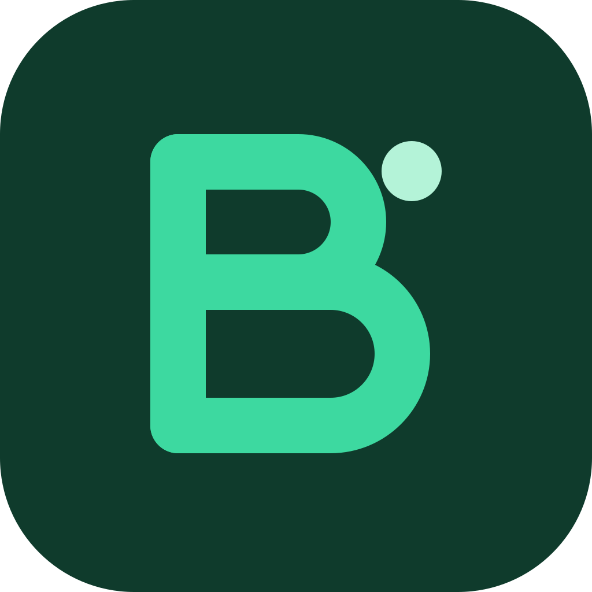

# Budgity



Offline-first personal finance app for **Android** and **Windows**, built from one Flutter codebase.
Each device keeps its own SQLite database (Drift) and syncs automatically through Supabase
(PostgreSQL + Auth + RLS) whenever it is online.

## Stack

| Concern | Choice |
|---|---|
| UI / language | Flutter + Dart |
| State | Riverpod (plain providers, no codegen) |
| Navigation | GoRouter |
| Local DB | SQLite via Drift |
| Cloud | Supabase PostgreSQL, Auth, RLS, RPC |
| CI | GitHub Actions |

## How it works (one paragraph)

The UI only reads from local SQLite streams. Every write stores the row **and** a sync-queue entry in a
single local transaction. A `SyncEngine` pushes queued ops to the `sync_push` RPC (idempotent, version-checked),
then pulls remote changes by a server-assigned `change_seq` cursor. Concurrent edits from two devices become
explicit conflicts the user resolves; nothing is merged or dropped silently. See
[docs/synchronization.md](docs/synchronization.md).

## Setup

1. Flutter stable (≥ 3.47), Visual Studio Build Tools 2022 with **Desktop C++ + C++ ATL**
   (`flutter_secure_storage` needs `atlstr.h`), Android SDK + cmdline-tools (Android).
   On Windows enable **Developer Mode** (plugins need symlinks): `start ms-settings:developers`.
2. `flutter pub get`
3. Copy `env.example.json` to `env.json` and fill in your Supabase URL and **publishable** key.
4. Apply the backend: `supabase link --project-ref <ref>` then `supabase db push`.
5. Run: `flutter run -d windows --dart-define-from-file=env.json`

Run two "devices" on one PC: add `--dart-define=DB_NAME=device2` to a second instance.

### Code generation

Drift files (`*.g.dart`) are generated and committed. Never edit them by hand; regenerate with
`dart run build_runner build`. CI fails if they are out of date.

### Signed Windows release

Unsigned builds trigger SmartScreen's "Unknown publisher" warning. To sign with the Certum
open-source cert, connect SimplySign Desktop, then:

```powershell
flutter build windows --release --dart-define-from-file=env.json
powershell -ExecutionPolicy Bypass -File tool/sign_windows.ps1
```

Distribute the signed `build/windows/x64/runner/Release` folder. CI artifacts stay unsigned.

## Tests

- `flutter test`: unit and widget tests (money, repositories, sync engine with a fake server).
- `supabase start && supabase test db`: pgTAP tests for RLS, versioning, and idempotency.
- `flutter test test/integration`: two-device sync against local Supabase (needs `supabase start`).
- `flutter test integration_test -d windows`: on-device plugin checks (secure storage, DB file purge).

## Docs

[Requirements](docs/requirements.md) · [Architecture](docs/architecture.md) ·
[Database schema](docs/database-schema.md) · [Synchronization](docs/synchronization.md) ·
[Security](docs/security.md) · [Testing](docs/testing.md) · [Roadmap](docs/development-roadmap.md) ·
[Decisions](docs/decisions/)

## License

[MIT](LICENSE)
