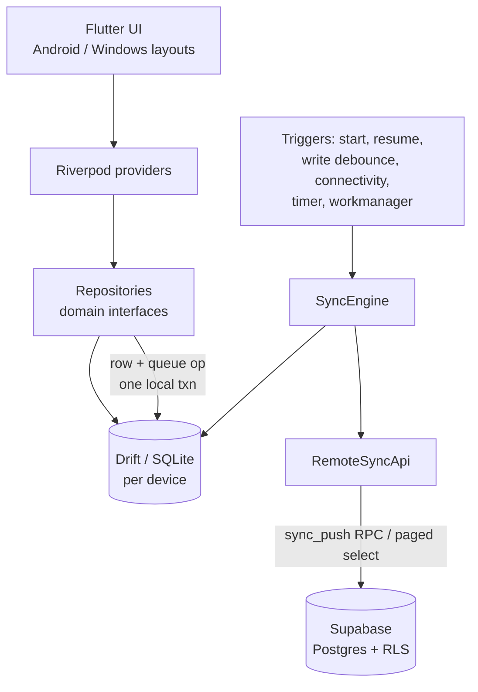

# Architecture



## Rules

1. **Local-first reads.** Widgets watch Drift streams and never call the network.
2. **Local-first writes.** A repository writes the row and its queue op in one Drift transaction.
3. **Repository boundary.** Widgets never touch SQL or Supabase directly.
4. **One sync path.** Every trigger calls `SyncEngine.run()`, which is single-flight and, on Android, guarded by a DB lease.
5. **Shared domain logic.** Money, validation, and budget math live in `lib/core` / `domain/` and are platform-agnostic.

## Layout

```
lib/
  app/            app.dart, router.dart, theme
  core/           money, connectivity, errors
  database/       app_database.dart, tables, daos (generated *.g.dart committed)
  features/<f>/   data (Drift impls), domain (interfaces, models), presentation (screens)
  shared/widgets/ adaptive scaffold, common widgets
supabase/         migrations, pgTAP tests
test/             unit, widget, integration
```

## Components

| Component | Responsibility |
|---|---|
| `AppDatabase` | Schema, migrations, DAOs. |
| `*Repository` | Domain API. Mutations enqueue sync ops atomically. |
| `SyncDao` | Queue coalescing, applying pulled rows, cursors, conflicts. |
| `RemoteSyncApi` | Supabase transport (`sync_push`, paged pulls, fetch by id). Faked in tests. |
| `SyncEngine` | Readiness check, push, pull, apply, cursor, status (see synchronization.md). |
| `SupabaseService` | Client init with secure-storage session persistence. |
